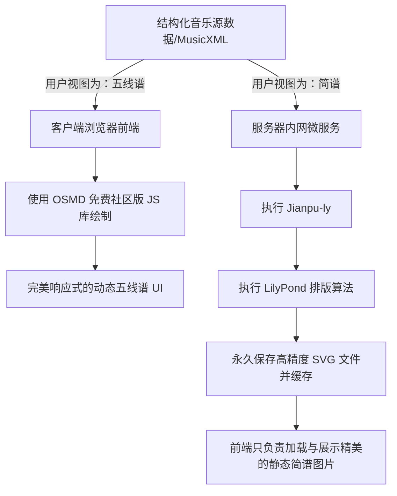

# 钢琴乐谱渲染技术架构选型与调研报告

## 1. 业务背景与面临的痛点

在 PianoEase 项目的 Web MVP 环境中，乐谱主要分为**简谱** (Numbered Musical Notation) 和**五线谱** (Western Staff Notation) 两种视图呈现。
原先的开发预期是通过诸如 `JianpuRender` 等极轻量的纯 JS 开源库来在前端进行简谱的直接渲染。然而，经过真实数据的尝试，暴露出了极其严重的大谱表（Grand Staff）脱节痛点：

* **底层数据结构的先天劣势**：简谱传统意义上仅仅服务于单声部单音旋律（如人声演唱或西洋管乐）。现如今绝大多数纯前端的开源简谱库（包括 `react-jianpu`、`Musje` 以及 `JianpuRender`），在底层排版引擎（Layout Engine）上仅能进行水平线性排版。
* **双手同步排版能力缺失**：当处理左右手同时弹奏的钢琴谱时，由于缺乏全局时间轴拍子切片技术，左右手的数据被库渲染成了两条完全互不相关的平行字符串线。不同时值的音符无法通过贯穿小节线来进行严格对齐。

因此，亟需重新评估多轨（带和声/复调）简谱和五线谱的底层渲染架构技术。

## 2. “双手钢琴简谱”的前端渲染方案调研评估

经过针对 Web 端“双手钢琴简谱”处理方案的详尽市场技术摸底，共有如下四种解题思路：

### 方案一：OpenSheetMusicDisplay (OSMD) 原生简谱模式 [付费赞助/门槛较高]
* **原理**：直接传递标准钢琴双轨的 MusicXML 给 OSMD 库，设置 `osmd.EngravingRules.JianpuAlwaysUsed = true;`。利用该引擎强大的五线谱排版内核，将五线谱音符降维映射为数字。
* **优势**：包含最完美的版面算法、自适应换行、原生保留光标跟随和试听播放能力，是完全在前端运行的“终极方案”。
* **劣势**：该核心扩展特性目前尚处于开源库的“Sponsor-only（需月度付费赞助，起步约 $14/月）”体验阶段中的私有分支（如 `feat/jianpu`）。不具备免费直接白嫖的条件。

### 方案二：Jianpu-ly + GNU LilyPond [优质纯后端静态呈现，现阶段推荐最佳方案]
* **原理**：采用英国剑桥大学研究员维护的 Python 预处理器 `Jianpu-ly` 把包含分轨结构的纯文本简谱直接转化成 LilyPond 代码。接着在服务器进程中执行 LilyPond 进行打谱，直接输出高质量并且支持任意缩放的矢量图片 (SVG)。
* **优势**：
  * 排版质量直接触达出版级天花板，LilyPond 拥有世界一流水准的大谱表防碰撞与连音线引擎，完全不存在任何脱节和错位的问题。
  * 完全免费。
  * 可顺手附带输出精确的 MIDI 音频文件。
* **劣势**：失去了极强的前端交互性。由于下发的是 SVG 静态图片，“点击某个音发音”或者“按时间精确移动当前进度光标高亮”等功能将极难实现。

### 方案三：abc2svg 及其 jianpu 扩展特性 [边缘方案]
* **原理**：利用 ABC 文本打谱语言强行渲染出简谱字符（使用 `%%jianpu 1` 特性参数）。
* **优势**：免费的前端 JS 方案。
* **劣势**：双手钢琴谱对于 ABC 取值写法非常生硬冗杂，其处理复杂连跨音轨以及不同密度的音符缩进对齐时，视觉效果极差，达不到商用 MVP 的及格线。

### 方案四：Fork 当前单轨轻量库暴改 [极高隐性成本]
* **原理**：继续保留 `JianpuRender` 库，组织前端人员专门研发一套“多轨节拍尺同步对齐排版算法”。
* **优势**：技术栈纯粹，无后端依赖。
* **劣势**：这是一个隐形的排版黑洞，实现真正的自适应对其算法对初创小团队性价比极低，很容易出现 Bug 和无休止的边角特例微调。

---

## 3. 架构选型结论与双线排版策略

基于以上分析，且考虑到业务起步阶段**暂无意向缴纳高阶商业赞助费**、同时**对静态乐谱的精确度和美观度要求优先级远大于琴谱游标的动态点按级交互**，总结出以下平行排版渲染架构与落地方案：

### 结论一：简谱部分，撤销前端渲染，转入“后端打谱下发静态 SVG 图片”模式
由于免费前端界缺乏该领域的成熟工具，应当扬长避短：
1. 后端引入 `Jianpu-ly` 和 `LilyPond` 依赖。
2. 业务流程：系统录入结构化音乐数据 -> 后端服务转化为文本打谱语料并编译成 SVG 矢量图 -> 上传大图片至云端 / CDN 取得链接 -> 手机 Web 端的图床组件进行加载展示（配合可移动缩放视图）。
3. 这一方案开发介入成本最低、版面质量最有保障。由于只做看谱功能，这完全契合当前用户的第一诉求。

### 结论二：五线谱部分，坚持采用完全在前端动态渲染的开源引擎（不得用图片替代）
绝不可以用上述“后端发死图片”的逻辑同时处理五线谱。因为：
1. **开源前端的红利极致丰厚**：针对常规五线谱，OSMD 主干分支和 Verovio 等前端引擎是**完全免费开源**且商业可用级别的。面对复杂的古典多轨钢琴谱也是开箱即用的丝滑。
2. **极佳的移动端响应式体验（Reflow）**：五线谱依赖客户端浏览器的环境进行换行计算。用后端传图片会将谱面的行数列数锁死，导致手机用户必须左右不停横划（毁灭级体验），而利用 OSMD 引擎进行直接渲染可以做到自适应设备的屏幕尺寸并重新分行。
3. **零服务器成本及未来潜力留存**：五线谱的解析全部依赖客户端 GPU / JavaScript 算力进行，减轻服务器开支，同时为下一迭代的智能交互打好基础架构兜底（OSMD 天然支持读取 DOM 中被精准高亮的音符）。

### 最终数据流向模型总览

